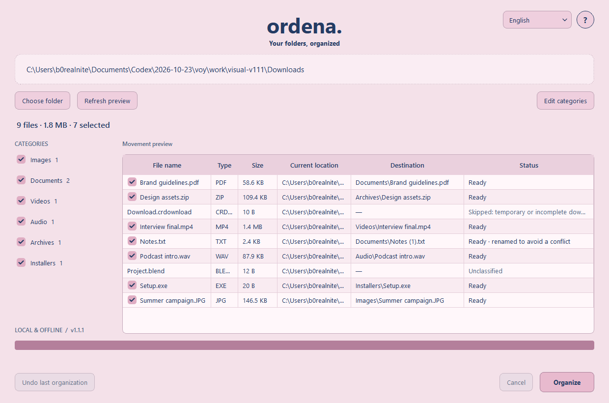

# Ordena

A free, offline Windows desktop app for organizing a mixed folder. Built with Python 3.12 and PySide6. **English is the initial language; choose Español in the top-right selector.** Language, category rules and last selected folder are remembered.

[Instrucciones en español](README.es.md)



## Run the portable app

Extract the entire portable ZIP and open `Ordena/Ordena.exe`. Keep `_internal` beside the executable. No Python or administrator permissions required. This initial build is unsigned; a clean Windows installation has not yet been tested.

## How it works

1. Choose a folder or drag one into the window.
2. Review the proposed moves, including collision-safe destination names.
3. Uncheck individual files or entire categories. Edit category names/extensions if needed.
4. Click **Organize** and confirm the selected folder and count.
5. Review completed/skipped/error counts. **Undo last organization** also works after restarting.

Only files directly inside the selected folder are considered. Existing subfolders stay intact. Images, Documents, Videos, Audio, Archives and Installers are included; unmatched files stay where they are. Changing interface language never renames destination folders. To use Spanish destination names, edit category rules explicitly.

Preview does not create folders or move files. Classification uses extensions only; SHA-256 checksums read bytes solely to detect changed/replaced files, without decoding, displaying, launching or executing them. Locked, changed, hidden/system, temporary, shortcut, symbolic-link, junction and hard-linked files are skipped. Drive roots, protected system paths and paths through reparse points are rejected.

Moves use Windows handles with writers/deleters excluded and `FileRenameInfo.ReplaceIfExists=False`. Directory handles prevent directory replacement during moves. Newly appeared conflicts are skipped instead of silently changing the reviewed destination. Cancel stops before the next file and preserves the completed moves for undo. A large file's checksum must finish before cancellation takes effect.

Undo verifies identity, size, modification time and SHA-256, never overwrites a newly occupied original location, and removes only empty folders created by that operation with matching filesystem identity. A durable SQLite intent is committed before each rename, and the completion afterward, so interruption between them can be reconciled by Undo. Unresolved conflicts remain available for retry. After undoing the latest recoverable operation, an earlier recorded operation may become available.

Preferences and history are stored locally in the per-user Qt AppLocalDataLocation (`IvanSolano/Ordena` under Local AppData). `ORDENA_DATA_DIR` can override this path for isolated tests. Do not delete the history if you still need undo. Only one app instance per data directory is allowed.

## Development on Windows

Install Python 3.12 (64-bit), then in PowerShell from this folder:

```powershell
.\setup.ps1
.\.venv\Scripts\python.exe main.py
```

Or run `python -m venv .venv`, then `.\.venv\Scripts\python.exe -m pip install -r requirements-dev.txt`. Select `.venv` in VS Code. Runtime does not need internet; installation downloads dependencies. This development session used Python 3.12.14, PySide6 6.10.2 and PyInstaller 6.19.0 in an isolated virtual environment.

```powershell
.\.venv\Scripts\python.exe -m unittest discover -s tests -v
.\build.ps1
```

The build produces `dist/Ordena/Ordena.exe`; distribute its entire folder. `--smoke-test` opens the app then closes it automatically for startup verification. Tests use synthetic files in temporary directories only. All 35 tests, Windows packaging and executable startup without Python on PATH passed in [Windows CI](https://github.com/wasatnight/Ordena/actions/runs/39929305957). See [VALIDATION.md](VALIDATION.md) for actual results and limitations, and [CONTEXTO_PROYECTO.md](CONTEXTO_PROYECTO.md) to continue development.

## Structure

- `ordena/ui.py`, `i18n.py`: interface and English/Spanish strings.
- `rules.py`, `planner.py`: rule validation and read-only preview.
- `safety.py`, `executor.py`: Windows guards, locking, execution and undo.
- `journal.py`, `settings.py`: durable movement history and preferences.
- `workers.py`: cancellable background tasks.
- `tests/`: filesystem safety and interface integration tests.

Automatic watching, background/startup operation, recursion, AI, duplicate deletion, cloud sync and donations are deliberately deferred. Authenticode signing, an installer and testing on a separate clean Windows machine remain future distribution work.

Author: Iván Solano. The author's source license is pending selection; no open-source license is granted solely by making the repository public. Third-party components retain their own licenses; see [TERCEROS.md](TERCEROS.md).

